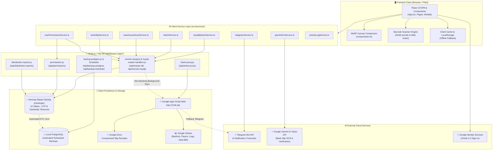

# System Architecture: IAL SYSTEMS

## 1. Architectural Pattern & Overview
IAL SYSTEMS employs a **Hybrid Client-Centric & Multi-Tier Persistence Architecture** (`Confirmed` - [vite.config.ts](file:///c:/Users/ASUS/OneDrive/Desktop/ialsystems_accounting-main/vite.config.ts#L7-L263), [src/App.tsx](file:///c:/Users/ASUS/OneDrive/Desktop/ialsystems_accounting-main/src/App.tsx)). 

The frontend operates as a Progressive Web Application (PWA) with responsive desktop and mobile views, offloading heavy computations (image compression, reconciliation diffing, audio generation) directly to the client browser. The backend is partitioned across three complementary layers:
1. **Express/Vite Middleware API Layer:** Local Node.js micro-services providing connection pooling to MySQL, PostgreSQL backup orchestration, and Google Sheets CORS proxies.
2. **Master Cloud Database (Hostinger MySQL):** Primary high-performance relational store for operational logistics data, user permissions, and warehouse scans.
3. **Google Cloud / Apps Script & Drive:** Cloud document storage for receipts, legacy spreadsheet backups, and Telegram alert dispatch.

---

## 2. Mermaid Architecture Diagram

---

## 3. Component Interaction & Data Flows

### A. Authentication & Session Flow
1. **Login Trigger:** The user logs in via Google OAuth 2.0, Admin PIN, or Email & Password (`Confirmed` - [src/components/LoginView.tsx](file:///c:/Users/ASUS/OneDrive/Desktop/ialsystems_accounting-main/src/components/LoginView.tsx)).
2. **Permission Resolution:** `userPermissionService.ts` queries the permissions API (`tbl_permissions`), extracts the user's role, page authorization list (`allowedPages`), and data scope (`viewOnlyOwn`).
3. **Session Persistence:** Session info is stored in browser `localStorage` (`accounting_app_auth_user_v2`).
4. **Route Guard:** `src/App.tsx` evaluates `canUserAccessPage(user, currentView)` before mounting pages.

### B. Payment Batch Creation & Double-Sync Pipeline
1. **Data Entry:** Cashier enters items or scans barcodes in `PaymentCollectionPage.tsx`.
2. **Local Validation:** Currency calculations, totals, and reconciliation differences (`diffUSD`, `diffKHR`) are computed in real-time.
3. **Master DB Commit:** `batchService.ts` sends a POST request to `/api/master-db` with action `SAVE_BATCH`.
4. **Relational Write:** `api/mysql-master-handlers.js` writes the batch header into `tbl_batches` and individual line items into `tbl_collection_items` inside a database transaction (`Confirmed` - [api/mysql-master-handlers.js](file:///c:/Users/ASUS/OneDrive/Desktop/ialsystems_accounting-main/api/mysql-master-handlers.js#L414-L498)).
5. **Non-blocking Cloud Replication:** In parallel, `triggerBackgroundSyncToGoogle()` sends the payload asynchronously to the Google Apps Script Web App (`Code.gs`) to update the Google Sheet tab.
6. **Telegram Dispatch:** `telegramService.ts` formats an aesthetic Khmer markdown message summarizing the batch and fires an HTTPS request to Telegram Bot API.

### C. Warehouse Scanning Flow
1. **Barcode Capture:** Operator scans tracking numbers via hardware USB laser scanner or device camera (`html5-qrcode`).
2. **Audio Feedback:** Synthesizes immediate high-pitch tone on successful read or low-pitch tone on duplicate/error (`src/utils/scannerSound.ts`).
3. **Auto Lookup:** The system cross-references `DataReport` or `tbl_data` to auto-populate destination, consignee, and COD values.
4. **Operation Mode Storage:** Entries are persisted into their respective table (`tbl_scan_in`, `tbl_scan_out`, `tbl_out_of_delivery`, `tbl_hold_remaining`).

### D. Bank Slip OCR & Archival Pipeline
1. **Image Selection:** User snaps or selects bank slip photo.
2. **Client Compression:** Canvas downsamples image to WebP (`< 200 KB`) while computing savings percentage.
3. **Gemini OCR Analysis:** Image base64 is sent to `@google/genai` to automatically extract beneficiary name, bank, and amount (`src/services/geminiOcrService.ts`).
4. **Storage:** Base64 is posted to Google Apps Script which saves the image directly into Google Drive and writes the metadata to `tbl_bank_slips`.
5. **Telegram Alert:** Dispatched to Telegram Slip Bot #4 with preview thumbnail.

---

## 4. Middleware & Resilience Mechanics

| Resilience Feature | Implementation Mechanism | Evidence |
| :--- | :--- | :--- |
| **MySQL Pool Recovery** | Automatic pool reset on connection reset, fatal enqueue error, or timeout | [api/remote-mysql.js](file:///c:/Users/ASUS/OneDrive/Desktop/ialsystems_accounting-main/api/remote-mysql.js#L43-L48) |
| **Non-blocking Google Sync** | `triggerBackgroundSyncToGoogle` executes inside un-awaited self-executing async function with 15s timeout | [api/mysql-master-handlers.js](file:///c:/Users/ASUS/OneDrive/Desktop/ialsystems_accounting-main/api/mysql-master-handlers.js#L20-L42) |
| **Stale Chunk Auto-Reload** | `lazyWithRetry` detects chunk load failures, purges caches, and performs single reload | [src/App.tsx](file:///c:/Users/ASUS/OneDrive/Desktop/ialsystems_accounting-main/src/App.tsx#L68-L103) |
| **Automated Auto-Backup** | Vite plugin interval timer checks `scripts/backup-schedule.json` every 45s and triggers child process | [vite.config.ts](file:///c:/Users/ASUS/OneDrive/Desktop/ialsystems_accounting-main/vite.config.ts#L13-L65) |
| **CORS Elimination** | `/api/sheet-proxy` relays Google Spreadsheet requests on server side | [api/sheet-proxy.js](file:///c:/Users/ASUS/OneDrive/Desktop/ialsystems_accounting-main/api/sheet-proxy.js) |
