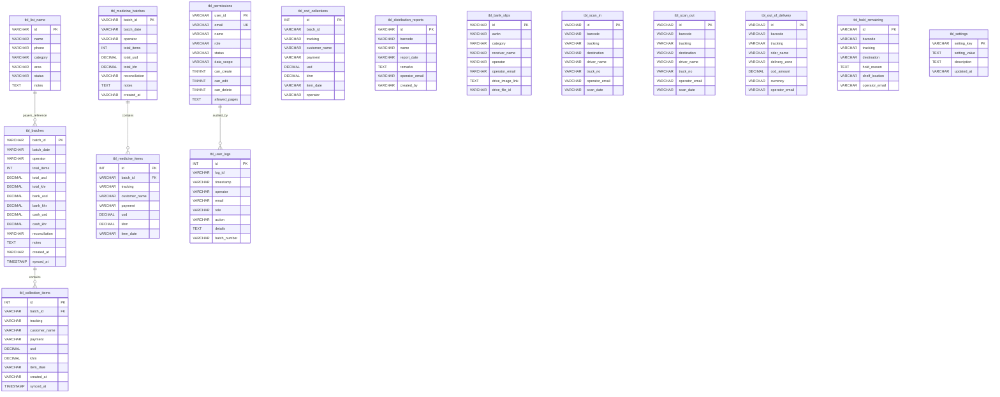

# Database Schema, Relationships & Data Flow: IAL SYSTEMS

## 1. Database Engines & Client Specifications

### A. Primary Master Database (Remote MySQL / MariaDB)
- **Host / Provider:** Hostinger Cloud (`Confirmed` - [api/remote-mysql.js](file:///c:/Users/ASUS/OneDrive/Desktop/ialsystems_accounting-main/api/remote-mysql.js#L21-L26)).
- **Engine:** InnoDB (`Confirmed` - [scripts/hostinger_mysql_schema.sql](file:///c:/Users/ASUS/OneDrive/Desktop/ialsystems_accounting-main/scripts/hostinger_mysql_schema.sql#L32)).
- **Character Set & Collation:** `utf8mb4` with `utf8mb4_unicode_ci` (full Khmer script fidelity).
- **Timezone:** Fixed Cambodia Local Timezone `+07:00` (Asia/Phnom_Penh).
- **Client & Driver:** `mysql2/promise` with connection pooling (connection limit: 5, keep-alive: 10s, auto-reconnect on socket loss).
- **Data Access Pattern:** Parameterized prepared statements; transaction-safe batch operations (`START TRANSACTION`, `COMMIT`, `ROLLBACK`).

### B. Local Backup Database (PostgreSQL)
- **Engine:** PostgreSQL 14+ (`Confirmed` - [package.json](file:///c:/Users/ASUS/OneDrive/Desktop/ialsystems_accounting-main/package.json#L31), [scripts/init_schema.sql](file:///c:/Users/ASUS/OneDrive/Desktop/ialsystems_accounting-main/scripts/init_schema.sql)).
- **Client & Driver:** `pg` Pool.
- **Role:** Automated snapshots of operational batches, warehouse scans, and user logs for on-premise disaster recovery.

### C. Cloud Storage & Spreadsheets (Google Drive & Sheets)
- **Storage:** Google Drive via Google Apps Script Base64 byte-stream uploader (`Code.gs`).
- **Sheets:** Multi-tab workbook functioning as human-auditable ledger.

---

## 2. Sanitized Connection Configuration Placeholders

```env
# ===================================================
# SANITIZED DATABASE CONFIGURATION (REFERENCE FORMAT)
# ===================================================

# Primary Master MySQL Database (Remote Hostinger Cloud)
REMOTE_DB_HOST="<REDACTED_HOST>"
REMOTE_DB_PORT="3306"
REMOTE_DB_USER="<REDACTED_USER>"
REMOTE_DB_PASSWORD="<REDACTED_PASSWORD>"
REMOTE_DB_NAME="<REDACTED_DB_NAME>"

# Local PostgreSQL Backup Database
PG_HOST="localhost"
PG_PORT="5432"
PG_USER="<REDACTED_PG_USER>"
PG_PASSWORD="<REDACTED_PG_PASSWORD>"
PG_DATABASE="ialsystems_backup"

# Google Workspace / Apps Script Endpoint
VITE_GOOGLE_WEBAPP_URL="<REDACTED_GOOGLE_SCRIPT_EXEC_URL>"
```

---

## 3. Entity-Relationship Data Model



---

## 4. Table Schema Reference (All 15 Relational Tables)

All tables verified in [scripts/hostinger_mysql_schema.sql](file:///c:/Users/ASUS/OneDrive/Desktop/ialsystems_accounting-main/scripts/hostinger_mysql_schema.sql):

| # | Table Name | Primary Key | Key Indexes | Purpose |
| :- | :--- | :--- | :--- | :--- |
| 1 | `tbl_batches` | `batch_id` | `idx_batches_date`, `idx_batches_operator` | Payment collection batch headers |
| 2 | `tbl_collection_items` | `id` (Auto) | `idx_items_batch`, `idx_items_tracking` | Individual parcel records in batch |
| 3 | `tbl_medicine_batches` | `batch_id` | `idx_med_batches_date`, `idx_med_batches_operator` | Pharmaceutical parcel batch headers |
| 4 | `tbl_medicine_items` | `id` (Auto) | `idx_med_items_batch`, `idx_med_items_tracking` | Individual pharmaceutical line items |
| 5 | `tbl_cod_collections` | `id` (Auto) | `idx_cod_batch`, `idx_cod_tracking`, `idx_cod_date` | COD parcel collection records |
| 6 | `tbl_list_name` | `id` | `idx_list_name_name`, `idx_list_name_category` | Payers (Riders, Branches, Partners) |
| 7 | `tbl_distribution_reports` | `id` | `idx_dist_barcode`, `idx_dist_date` | Parcel dispatch & delivery confirmations |
| 8 | `tbl_bank_slips` | `id` | `idx_slip_awbn`, `idx_slip_operator` | Bank transaction slips and Drive links |
| 9 | `tbl_permissions` | `user_id` | `uniq_perm_email` (Unique), `idx_perm_role` | RBAC and page authorization rules |
| 10 | `tbl_user_logs` | `id` (Auto) | `idx_log_operator`, `idx_log_action` | Immutable user activity audit trail |
| 11 | `tbl_scan_in` | `id` | `idx_scan_in_barcode`, `idx_scan_in_date` | Warehouse intake scan records |
| 12 | `tbl_scan_out` | `id` | `idx_scan_out_barcode`, `idx_scan_out_date` | Warehouse dispatch scan records |
| 13 | `tbl_out_of_delivery` | `id` | `idx_ood_barcode`, `idx_ood_rider` | Rider hand-off and COD assignments |
| 14 | `tbl_hold_remaining` | `id` | `idx_hold_barcode`, `idx_hold_location` | Undelivered retained parcel log |
| 15 | `tbl_settings` | `setting_key` | None | Key-value application configurations |

---

## 5. Caching, Storage & Synchronization Lifecycle

### A. Client-Side Browser Storage
- **`accounting_app_auth_user_v2`:** Logged-in user profile, role, session expiration, and allowed pages.
- **`accounting_app_settings_v2`:** Exchange rate, active sheets URLs, Telegram Bot tokens, dark mode preference.
- **`accounting_app_user_permissions_v2`:** Cached permissions for instant offline authorization checks.
- **`accounting_app_saved_batches_v1`:** Local queue of collection batches enabling offline entry before synchronization.

### B. In-Memory Server Caching
- **`globalThis.__ial_mysql_pool`:** Singleton connection pool maintained across Vite hot module reload cycles to prevent connection leakage.
- **`localDbService.ts` In-Memory State:** Subscriptions to in-memory state listeners for reactive React UI re-rendering.

### C. Backup & Data Pipeline Synchronization
1. **Real-Time Operational Writes:** Writes commit immediately to Remote MySQL.
2. **Asynchronous Background Sync:** Fires non-blocking JSON POST to Google Apps Script (`Code.gs`) with a 15-second abort signal timeout.
3. **Automated Scheduled PostgreSQL Dump:**
   - Evaluates `scripts/backup-schedule.json` every 45 seconds.
   - If scheduled daily time (e.g. `18:00`) or interval has elapsed, invokes `scripts/backup-to-postgres.js`.
   - Extracts delta records from MySQL and inserts them into PostgreSQL with updated timestamp metrics.
