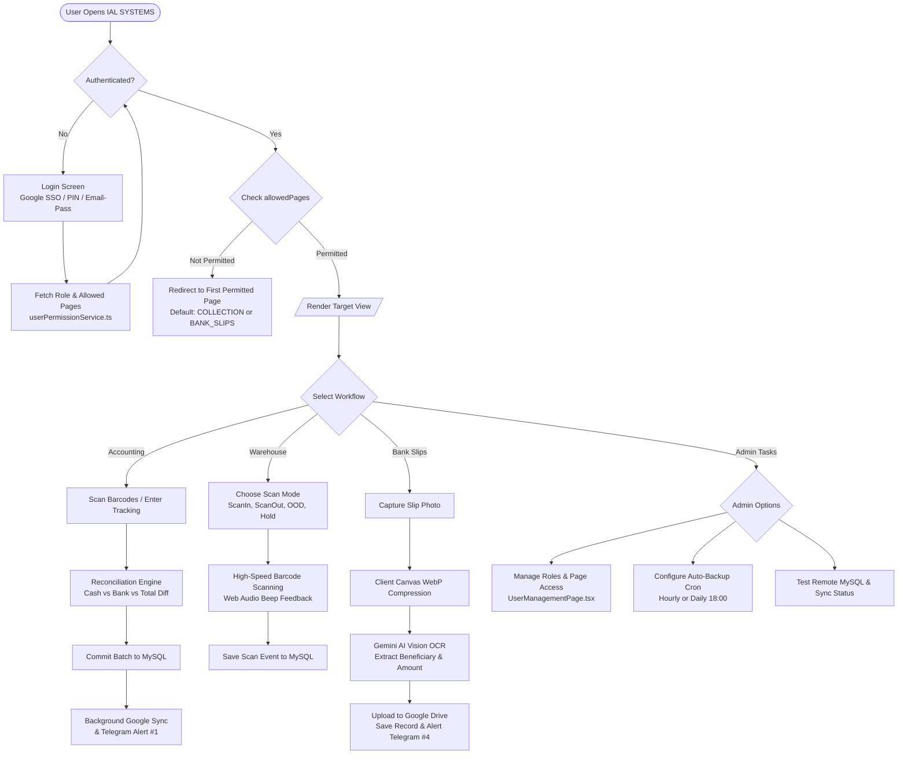

# Routes, Navigation & User Flows: IAL SYSTEMS

## 1. Page Routing & View Hierarchy

Because IAL SYSTEMS is architected as an offline-capable Single Page Application (SPA) with dynamic permission-guarded state switching, navigation is driven by the `NavView` enum managed in [src/App.tsx](file:///c:/Users/ASUS/OneDrive/Desktop/ialsystems_accounting-main/src/App.tsx#L3200-L3390) rather than a multi-page browser reloader (`Confirmed`).

```
App.tsx (Root View Container)
├── Authenticated Navigation Shell
│   ├── Sidebar.tsx (Desktop Collapsible Navigation Menu)
│   ├── Navbar.tsx (Top Status Bar, User Profile, Dark Mode, Quick Stats)
│   └── MobileBottomNav.tsx (Mobile Responsive Sticky Bottom Navigation)
└── Views (Conditional Route Rendering)
    ├── COLLECTION (PaymentCollectionPage.tsx) [Default Landing]
    ├── PAYERS (PayerManagementPage.tsx)
    ├── DATA (DataManagementPage.tsx)
    ├── DATA_BM (DataBMPage.tsx)
    ├── FOLLOWUP_BM (FollowUpBMPage.tsx)
    ├── SOKIMEX_POSTPAID (SokimexPostpaidPage.tsx)
    ├── BANK_SLIPS (BankSlipsPage.tsx)
    ├── DATA_REPORT (DataReportPage.tsx)
    ├── METERIAL_OFFICE (MeterialOfficePage.tsx)
    ├── DISTRIBUTION_REPORT (DistributionReportPage.tsx)
    ├── WAREHOUSE / SCAN_IN / SCAN_OUT / OUT_OF_DELIVERY / HOLD_REMAINING (WarehouseManagementPage.tsx)
    ├── IALE_TRACKING (IaleTrackingPage.tsx)
    ├── PERMISSIONS (UserManagementPage.tsx) [Restricted to Admins]
    └── SETTINGS (SettingsPage.tsx / SettingsModal.tsx) [Restricted to Admins]
```

---

## 2. Role-Based Navigation Access Matrix

Defined in [src/services/userPermissionService.ts](file:///c:/Users/ASUS/OneDrive/Desktop/ialsystems_accounting-main/src/services/userPermissionService.ts#L197-L210) (`Confirmed`):

| Page View Identifier | Khmer Title | Admin / Accountant Manager | CS Teams / Opt | Hub / Opt | Delivery / Rider |
| :--- | :--- | :---: | :---: | :---: | :---: |
| `COLLECTION` | ប្រមូលប្រាក់ (Collection) | ✅ Full | ✅ Full | ✅ Full | ❌ Restricted |
| `PAYERS` | បុគ្គលិក / អ្នកទូទាត់ (Staff) | ✅ Full | ✅ View/Edit | ❌ Restricted | ❌ Restricted |
| `DATA_BM` | Data_BM (Buymed) | ✅ Full | ✅ Full | ❌ Restricted | ❌ Restricted |
| `FOLLOWUP_BM` | FollowUp_BM | ✅ Full | ✅ Full | ❌ Restricted | ❌ Restricted |
| `SOKIMEX_POSTPAID` | Sokimex Postpaid | ✅ Full | ❌ Restricted | ❌ Restricted | ❌ Restricted |
| `BANK_SLIPS` | បង្កាន់ដៃធនាគារ (Bank Slips) | ✅ Full & Verify | ❌ Restricted | ❌ Restricted | ✅ Upload Slips |
| `DATA_REPORT` | Data Report | ✅ Full | ✅ View | ✅ View | ❌ Restricted |
| `METERIAL_OFFICE` | Meterial_Office (Truck/TukTuk) | ✅ Full | ✅ View | ✅ View | ❌ Restricted |
| `DISTRIBUTION_REPORT`| របាយការណ៍ចែកចាយ | ✅ Full | ✅ Full | ✅ Full | ✅ Own Reports |
| `SCAN_IN` | ScanIn (ចូលឃ្លាំង) | ✅ Full | ✅ View/Scan | ✅ Full | ❌ Restricted |
| `SCAN_OUT` | ScanOut (ចេញពីឃ្លាំង) | ✅ Full | ❌ Restricted | ✅ Full | ❌ Restricted |
| `OUT_OF_DELIVERY` | Out of Delivery (Rider) | ✅ Full | ❌ Restricted | ❌ Restricted | ✅ Full |
| `HOLD_REMAINING` | នៅសល់ក្នុងឃ្លាំង (Hold) | ✅ Full | ✅ View | ✅ Full | ❌ Restricted |
| `IALE_TRACKING` | IALE Tracking Live API | ✅ Full | ✅ View | ✅ View | ❌ Restricted |
| `PERMISSIONS` | គ្រប់គ្រងសិទ្ធិ (Users & Roles) | ✅ Admin Only | ❌ Forbidden | ❌ Forbidden | ❌ Forbidden |
| `SETTINGS` | ការកំណត់ (System Settings) | ✅ Admin Only | ❌ Forbidden | ❌ Forbidden | ❌ Forbidden |

---

## 3. Step-by-Step User Journeys

### Journey 1: Cashier Batch Collection & Financial Reconciliation
1. **Initiation:** Cashier navigates to `COLLECTION` view.
2. **Barcode / Tracking Input:** Cashier scans parcel barcode via camera scanner or enters tracking code.
3. **Lookup Auto-fill:** System queries `tbl_data` / `tbl_collection_items` to auto-fill recipient name, COD fee, and currency.
4. **Payment Method Selection:** Cashier selects Cash, ABA Pay, Wing, or ACLEDA Mobile.
5. **Multi-Currency Cash Count:** Cashier keys in physical bank denominations (USD and KHR).
6. **Balance Check:** System evaluates:
   $$\text{Diff USD} = (\text{Cash USD} + \text{Bank USD}) - \text{Total USD Expected}$$
   $$\text{Diff KHR} = (\text{Cash KHR} + \text{Bank KHR}) - \text{Total KHR Expected}$$
7. **Batch Commit:** Cashier presses "Commit Batch". Data is written to `tbl_batches` & `tbl_collection_items`.
8. **Cloud & Telegram Broadcast:** Triggered asynchronously to Google Apps Script and Telegram Bot #1.

---

### Journey 2: Warehouse Barcode Ingestion & Distribution
1. **Mode Selection:** Operator switches to `SCAN_IN`, `SCAN_OUT`, `OUT_OF_DELIVERY`, or `HOLD_REMAINING`.
2. **High-Speed Scanning:** Operator triggers USB laser scanner or device camera.
3. **Audio Feedback Loop:**
   - Single clean high beep: Valid tracking captured and appended.
   - Low double buzz: Duplicate barcode detected or already recorded.
4. **Metadata Augmentation:** If mode is `OUT_OF_DELIVERY`, operator assigns Rider Name and Route Zone. If `HOLD_REMAINING`, operator selects Hold Reason and Shelf Rack.
5. **Batch Persistence:** Records stream into `tbl_scan_in` / `tbl_out_of_delivery` on Remote MySQL.

---

### Journey 3: Bank Slip Upload, Compression & Gemini AI OCR
1. **Slip Selection:** Delivery courier or cashier captures customer payment slip in `BANK_SLIPS`.
2. **Client-Side Compression:** `compression.ts` renders image to hidden `<canvas>`, encodes to WebP at target resolution, yielding 80-90% size reduction.
3. **Gemini Vision OCR Analysis:**
   - Image base64 is dispatched to `geminiOcrService.ts` (`@google/genai`).
   - Extracts `amount`, `currency`, `bankName`, and `receiverName`.
4. **Drive Upload:** Apps Script saves file into Google Drive and stores `driveViewUrl` in `tbl_bank_slips`.
5. **Manager Verification:** `ACCOUNTANT_MANAGER` audits the uploaded slip and marks `isVerified = true`.
6. **Telegram Relay:** Broadcasts formatted image preview with verification tag to Telegram Bot #4.

---

## 4. Mermaid User Journey Flowchart


